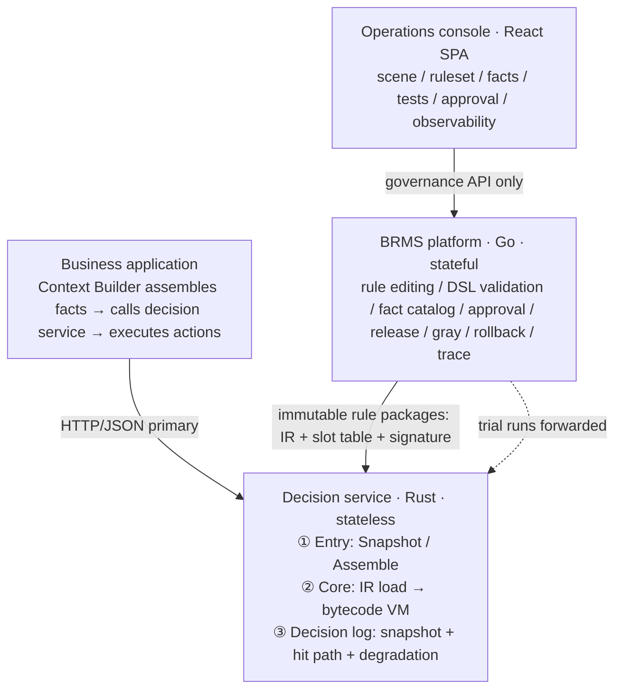

# GoldenRules Software Design Contract (ARCHITECTURE)

This file defines the layering and invariants of GoldenRules. Field-level contracts are published separately when external parties need to implement their own client or Provider. This document is a release snapshot generated from the Chinese source of truth; see the version header above.

> Any architectural change must update this document before the code changes. Invariants here and the field-level contracts together take precedence over plans and feature lists. When code and documentation disagree, the code and the contract win.

## 0 System-level architecture



*Reading the diagram:* there are three runtime processes plus the calling application. The engine is stateless and consumes only rule packages and the fact contract. The platform owns rule/fact/approval state and emits packages without reading engine runtime state. The console is a governance surface and is not on the decision path.

## 1 System positioning

- GoldenRules = **engine computation (an independent decision service)** + **BRMS operations (a governance platform)**.
- The engine is deployed as a **standalone service**, not an embedded SDK. HTTP/JSON is the primary entry point.
- Rule authors fall into three roles with layered permissions: engineers, business users, and agents. An agent may only submit drafts and can never publish.

## 2 Layering and dependency direction

### 2.1 Dependency direction (invariant A-1)

Dependencies flow in one direction only; reverse dependencies are forbidden:

- Business application → decision service (HTTP).
- Decision service → consumes **rule packages** and the **fact contract** only; it does not depend on the platform.
- BRMS platform → produces rule packages; it does not depend on engine runtime state.

The decision service is **stateless**: all state (package versions, fact catalog) is injected by the release process and is read-only at runtime.

### 2.2 Engine core boundary (invariant A-2)

The decision core is a **pure execution kernel**:

- It does not query databases, call remote services, or implement list matching, metric aggregation, or quota lookups.
- It does not own Context Builder concerns (parallelism, caching, timeouts, degradation) — except in Assemble mode, see below.
- It does not perform business actions (charging, posting entries, sending messages).
- It consumes only **immutable fact snapshots** and does not care where facts came from or how fresh they are.

**Sole exception:** in Assemble mode the service has built-in Providers that fetch and assemble facts. This is an entry-layer responsibility and **does not enter the execution kernel** — the kernel always sees an already-assembled snapshot.

> **Hard data-supply boundary:** data ingestion, fetching, cleaning, transformation (ETL), feature computation, and third-party data enrichment never enter the rules kernel and never exist as its "pre/post processors." Those responsibilities belong to an external Fact Provider / Context Builder, or to a separate data-supply system if needed. The rules side stores only **contracts** (field name, type, semantics, freshness, masking, version), never fetch logic.

### 2.3 Frontend architecture

The platform consists of a **web frontend + a Go backend**. The frontend is not on the decision critical path; it serves governance operators working on rules, facts, approvals, releases, and observability.

| Item | Choice |
|---|---|
| Framework | React + TypeScript |
| Styling | Tailwind CSS with shadcn-style local components |
| Decision table editing | TanStack Table (rows = rules, columns = condition dimensions) |
| Expression editing | Monaco Editor (whitelist operators, no free-form scripts) |
| Decision tree | React Flow (`@xyflow/react`), custom, with three degradation levels |

**Frontend information architecture:** scene strategy / ruleset / fact catalog / test cases / approval and release / observability and audit.

**How "authoring form is decoupled from runtime" is enforced (invariant A-10):**

- Expression, decision table, and decision tree are **views into the same ruleset**, sharing one DSL/IR. They are not peer modules and not a node-and-wire canvas.
- Scene strategy is an **ordered list of attached rulesets**, not a drag-and-connect flow canvas.
- The frontend has **no ETL / fetch / metrics menus** — only a fact-catalog contract view.

**Explicitly rejected technical decisions (as important as the accepted ones):**

- No `@republicroad/jdm-editor` or its upstream `@gorules/jdm-editor`: their JDM data model conflicts with our DSL/IR, and the fork is unstable with no reliable TypeScript types.
- No JDM / DMN / FEEL external decision formats. The single source of truth for the editor data model is our DSL/IR.
- The data model is the authority; a decision tree is a view that must compile losslessly back to `rules[]` (with `FIRST` hit strategy). Trees that cannot be represented that way are shown read-only with a specific reason.

## 3 Process model

| Process | Responsibility | State |
|---|---|---|
| Decision service (Rust) | Load rule packages, execute decisions, write decision logs, report limits | Stateless |
| BRMS platform (Go) | Rule/fact editing, validation, approval, release, gray, audit | Stateful (storage) |
| BRMS frontend (React SPA) | Governance UI; calls only the platform | Session state |

## 4 Compilation and execution chain

```
Rule source (JSON, version-controlled)
  → compile-time validation (existence / type / enum / nullable)
  → IR + slot table + signature
  → bytecode VM execution
  → DecisionResult + hit path + degradation flags
```

- The **slot table and signature** are frozen into the package; bytecode is **not** — the engine derives it from IR at load time. Pinning an execution backend into the artifact would force reissuing every historical package to change backends later.
- Field references are resolved to **slot indices at load time**, never by runtime string lookup.
- Rules are **pruned by scene and prerequisite facts** rather than scanned in full.
- Compilation is **atomic per package**: if any ruleset fails dry-run validation, the whole package is rejected with all diagnostics; nothing is partially stored.

## 5 Invariants (A-*)

| ID | Invariant |
|---|---|
| A-1 | Dependency direction is one-way: business → decision service → rule package; the service is stateless and read-only |
| A-2 | The execution core is pure: no fetching, no business actions, no external service calls |
| A-3 | Packages are released atomically and versions are immutable; rollback means switching to an older version |
| A-4 | Decision logs must carry: masked snapshot + fact catalog version + package version + hit rules + outputs + degradation flags + engine version + elapsed time |
| A-5 | Money uses exact decimal, never floating point; the single time baseline is `requestTime` |
| A-6 | Contract violations become a `REJECT` decision (`CONTRACT_VIOLATION`), never HTTP 500 |
| A-7 | Rule semantics are bounded: no loops, no side effects, whitelist-only operators |
| A-8 | Agents may only draft and can never publish |
| A-9 | Shared execution must have resource limits (per-package timeout / memory / rule count / snapshot size) |
| A-10 | Expression, decision table, and decision tree are views of one ruleset over one DSL/IR — not peer modules and not a flow canvas |

## 6 Contract surface

The contracts define the field-level behavior of the system:

| Area | Scope |
|---|---|
| DSL and IR | Rule syntax, IR structure, hit strategies, compilation contract, rule package |
| Fact contract | Fact schema, `FactSnapshot`, fact metadata, precision, version compatibility |
| Decision contract | `DecisionResult`, decision enums, reason codes, scene outputs, logs, replay |
| Approval matrix | Submitter type × risk level matrix, separation of duties, gray-release coupling |
| Error and degradation | Error codes, degradation matrix, validation pipeline, decision enums |
| Lifecycle | Package versions, effective time, release state machine, gray release, rollback, audit |

Contract enums, field names, JSON keys, error codes, and invariant IDs are not translated. They are the machine-readable surface used for reconciliation.

## 7 Key design trade-offs

| Trade-off | Decision | Rationale |
|---|---|---|
| Compilation artifact | IR + bytecode VM (not a pure interpreter, not WASM) | Keep the core hot path fast while leaving IR as the portable, inspectable artifact |
| Money precision | Decimal (not integer cents) | Safer for general currency arithmetic |
| Impact analysis | Executable (comparison run + boundary probes + fail-on-change) | A textual diff cannot tell you whether a decision changed |
| Multi-tenancy | Fields only; no isolation logic in the first release | Internal tool, not a SaaS product |
| Idempotency | Semantics defined, no caching | Decisions are side-effect-free and cheap to repeat |
| Degradation | An orthogonal dimension; no `DEGRADE` decision value | Execution quality must not be mixed into the business conclusion |
| Fact supply | Two entry modes: Snapshot and Assemble | Reconciles "the engine does not fetch" with practical local use |
| Editor | Self-built over the shared DSL/IR | Keep one source of truth and avoid conflicting data models |
| Decision graph canvas | Not in the first release; decision tree added later as a losslessly compilable view | Avoid a flow canvas where moving a node would not change evaluation |

## 8 Known limitations

- The built-in HTTP transport is `http://` only (no TLS); production uses an internal network or a sidecar.
- Scene-level `fallbackDecision` is not wired into Assemble mode.
- A `null` value on a `nullable` fact is still treated as a type error in the current engine.
- Unknown routes currently reuse `VERSION_RULESET_NOT_FOUND`, so an unregistered endpoint can look like a missing ruleset. This is intentional debt, not a contract change.
- Gray release is configured by the platform but not yet consumed by the engine.
- Log collection depends on an external shipper reading engine stdout; no vendor KMS is integrated for key management.
- Replay requires the engine to still be able to load the historical package version referenced in the log.
- Resource limits are on by default and reject packages that were previously loadable but exceeded the new bounds.
