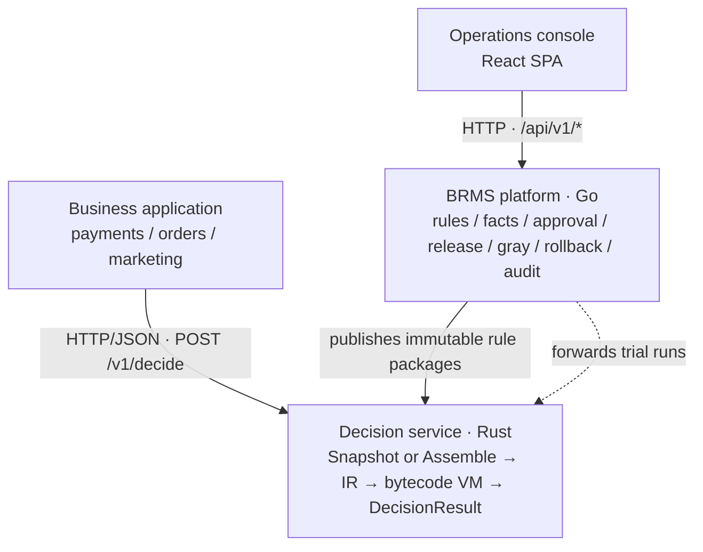

# GoldenRules

GoldenRules is a Business Rules Management System (BRMS) that takes a rule from authoring, validation, and approval to release and auditability. It combines an independently deployed decision service with a governance platform in a single repository.

> This is a release snapshot. It was generated from the Chinese source of truth at the version and commit named in the header above. If this document disagrees with another version of it, that is a release-process defect, not a matter of opinion: the external commitment is what you see here, while internal implementation follows the Chinese source.

## Architecture at a glance



*Reading the diagram:* dependencies point downward only. The engine consumes rule packages and the fact contract but never depends on the platform; the platform produces packages and never reads engine runtime state; the console calls only the platform and is not on the decision critical path.

## Run it locally

Requirements:

| Dependency | Minimum |
|---|---|
| Rust | stable |
| Go | 1.24+ |
| Node.js | 22+ |
| Bash (Git Bash on Windows) | any |

Keep the repository in a shallow directory. `web/node_modules` already contains paths 156 characters deep; placing the repo under a long path can exceed the Windows `MAX_PATH` limit, and Monaco's nested packages fail first.

```bash
# 1. Build and start the decision service (18080) and platform (18081)
cd backend && tools/dev-up.sh

# 2. Start the operations console
cd ../web && npm install && npm run dev      # http://localhost:5173
```

`dev-up.sh` builds both binaries, starts both processes, waits for both `/healthz` endpoints to return 200, then prints the addresses. Set `ENGINE_ADDR` / `PLATFORM_ADDR` if the default ports are taken; delete the data directory it prints to reset local state. On Windows use the equivalent scripts in `scripts/` (`build.bat`, `start-all.bat`, `stop-all.bat`).

The console talks only to the platform. Trial runs (`POST /v1/trial`) are forwarded by the platform because the engine is an unauthenticated internal service — exposing it cross-origin would make decision-making callable from any web page. The platform must start with `--cors-origin` (`dev-up.sh` does); without it the browser cannot read responses and the console reports `NETWORK_UNREACHABLE`.

## A minimal decision request

The decision endpoint accepts an `ExecutionContext` plus a `FactSnapshot`. The fixture below uses the `withdraw-risk-check` scene shipped with the repository:

```bash
curl -s http://127.0.0.1:18080/v1/decide \
  -H 'Content-Type: application/json' \
  -d '{
    "context": {
      "tenantId": "pay-cn",
      "scene": "withdraw-risk-check",
      "requestTime": "2026-10-30T10:00:00.123Z"
    },
    "snapshot": {
      "snapshotId": "fs-20261030-000123",
      "snapshotVersion": "v1",
      "tenantId": "pay-cn",
      "scene": "withdraw-risk-check",
      "factSchemaVersion": "catalog-v2026.10",
      "facts": {
        "request.amount": "1500",
        "request.currency": "CNY",
        "request.channel": "APP",
        "sanctions.hit": false,
        "customer.withdrawCount24h": 2,
        "customer.level": "NORMAL",
        "customer.riskScore": 620,
        "config.withdrawDailyLimit": "100000"
      },
      "factMeta": {
        "customer.withdrawCount24h": { "factVersion": "v1", "freshnessSec": 2 }
      },
      "missingFacts": [],
      "degradedFacts": [],
      "assembledAt": "2026-10-30T10:00:00.123Z",
      "assemblerVersion": "cb-v2.1"
    }
  }'
```

A successful response is a `DecisionResult`: `decision` / `reasonCode` / `outputs` carry the conclusion, `hitRules` and `evaluatedRules` explain how it was reached, and `degraded` / `degradedReasons` report any quality degradation. With the bundled fixtures the result is `REVIEW` with reason code `AMOUNT_REVIEW`. Contract violations do not become HTTP 500: they are returned as a `REJECT` decision with reason code `CONTRACT_VIOLATION` and HTTP 200.

The engine also exposes `POST /v1/assemble` (context + inputs → assembled facts → decision), `POST /v1/trial`, and the administrative `/v1/admin/reload` and `/v1/admin/verify` endpoints. See `ARCHITECTURE.md` for the contract and boundary rules.

## What works today

The full feature inventory with stable IDs is in `FEATURES.md`. In summary:

- **Execution:** IR compilation and bytecode VM, `FIRST` / `ALL` / `PRIORITY` hit strategies, exact decimal arithmetic, resource limits, and a whitelist-only expression language.
- **Authoring:** four interchangeable rule authoring forms over one DSL/IR — structured, expression, decision table, and decision tree — with server-side dry-run validation.
- **Governance:** fact catalog, test cases, a two-dimensional approval matrix with separation of duties, immutable rule packages with signature verification, gray release, and rollback.
- **Observability:** decision logs, masked views, encrypted raw snapshots with retention, replay pinned to the original package version, and a governance audit trail.
- **Operations console:** seven governance pages plus a local end-to-end test console, with six UI locales (`en` default, `zh-CN`, `ja`, `ar`, `fr`, `de`) including RTL support.

## Known limitations

These are constraints you will actually hit; they are listed deliberately.

- Trial runs execute the **package currently loaded by the engine**, not the draft in the editor. A newly authored ruleset returns `VERSION_RULESET_NOT_FOUND` until it is packaged, released, and reloaded. Validation is unaffected.
- Hot reload re-reads the paths given at startup; it cannot swap in a different package. Changing packages requires a restart.
- The built-in `HttpProvider` transport supports `http://` only (no TLS); production is expected to use an internal network or sidecar.
- Direct cross-origin access to the engine from a browser is intentionally unavailable — call through the platform.
- Unknown routes currently fall back to `VERSION_RULESET_NOT_FOUND`, so an unregistered endpoint can look like a missing ruleset.
- Execution resource limits are on by default (`max_inflight=256`, `max_instrs_per_package=400000`, `max_package_bytes=16 MiB`); larger but previously loadable packages are now rejected.

## Version and compatibility

This is the first public snapshot (`v0.1.0`), generated from commit `8c1f061`. The `version` and `source` fields in the header identify exactly which code this document describes. Field names, JSON keys, contract enum values, error codes, and invariant IDs are contract surface and are not translated or renamed between versions.

## Verify the build

```bash
cd backend && cargo test
cd backend/platform && go test ./...
cd web && npm run build
```
